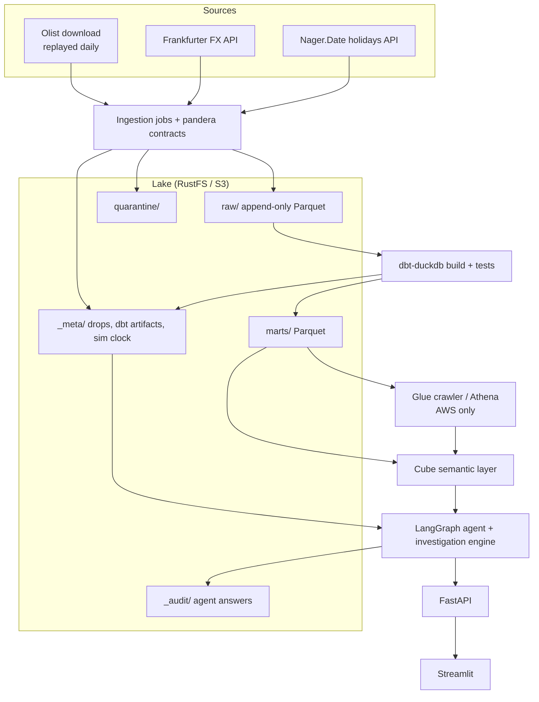

# MetricTrace — Build Specification (v2)

Oct 12, 2026 · @Debola · Revision of v1. Every change from v1 is listed in **Appendix: Changes from v1**. Later deviations are recorded in `docs/decisions/` (0002: RustFS replaces MinIO).

## Overview

MetricTrace is a governed metrics platform for an e-commerce marketplace. It includes an LLM agent that answers business questions and explains why a metric changed. The same code runs on a laptop with Docker and on AWS, and one environment variable switches between them.

**Business context.** The data is the real Olist Brazilian e-commerce dataset: about 100,000 orders from 2016 to 2018 across 9 tables. It is replayed as daily file drops so it behaves like a live source system. Olist stores only each order's *final* state, so the replay rebuilds each order's lifecycle from its timestamps (see **Replay rules**).

### Pain points the project solves

| Pain point | How it shows up at work | How MetricTrace addresses it |
| --- | --- | --- |
| Conflicting metric definitions | Finance, ops and marketing each report a different "revenue" | Every metric is defined once in a semantic layer, and ambiguous terms are resolved explicitly |
| Untrusted LLM SQL | Text-to-SQL tools invent joins and metric logic | The agent can query the semantic layer only through structured requests, never raw SQL |
| Slow root-cause analysis | A KPI drops and someone spends a day tracing it | A deterministic investigation engine decomposes the change and checks data health |
| Silent data quality failures | Duplicates, missing drops and schema drift reach dashboards | Contract checks at ingestion, dbt tests, completeness checks and reconciliation tests |
| Late-arriving and corrected data | Historical numbers change without explanation | Append-only raw zone; history is rebuilt from every version of each record, ordered by drop date |
| Immature recent periods | Last week's delivery rate looks bad only because deliveries are still pending | Each metric declares a maturity window, and the engine flags immature periods |
| "Data issue or real change?" | Teams cannot tell a pipeline fault from a business shift | The agent reports both data-health evidence and business drivers, and a written verdict matrix decides which one explains the change |

### Outcomes

1. A data lake with raw, staging and marts zones, fed by file and API ingestion.
2. A tested dbt project with staging, intermediate and mart layers.
3. A semantic layer that defines every business metric once.
4. A LangGraph agent with two modes: **Ask** (answers metric questions) and **Investigate** (explains a change).
5. An incident simulator that injects known faults, used to evaluate the agent.
6. One Helm chart that deploys to a local kind cluster and to Amazon EKS, with CI/CD in GitHub Actions.

### Non-goals

- No write actions: the agent and API are read-only.
- No real-time streaming; data arrives in daily batches.
- No multi-tenant auth; one bearer token protects the API.
- The dataset is CC BY-NC-SA 4.0, so the project stays non-commercial. The committed fixture carries the same licence and an attribution notice.

## Architecture and key decisions

The pipeline uses one SQL dialect (DuckDB) everywhere, so the SQL that CI tests is exactly the SQL that runs on AWS. Object storage is RustFS locally and S3 on AWS, both accessed through the same S3 API.

### Component flow



Data flows top to bottom. The agent never touches raw data or writes SQL, and every answer is logged to `_audit/`.

1. **Ingest:** Python jobs land Olist file drops and API data (FX rates, public holidays) in the raw zone as Parquet. Every drop writes a `_meta` record, including drops with zero rows.
2. **Transform:** dbt (dbt-duckdb) reads raw Parquet, runs tests, and writes marts back to the lake as Parquet.
3. **Publish:** dbt artifacts (manifest, run results, sources) are saved to the lake for the agent. On AWS, the publish step then starts the Glue crawler, which registers the marts.
4. **Serve:** Cube exposes the semantic layer over the marts. Locally it queries DuckDB over RustFS; on AWS it queries Athena over Glue tables.
5. **Reason:** the LangGraph agent calls typed tools: Cube queries, the investigation engine, dbt artifacts and data-health checks.
6. **Deliver:** FastAPI serves the agent, and Streamlit provides the chat UI.

### Technology decisions

| Concern | Local | AWS |
| --- | --- | --- |
| Object storage | RustFS | S3 (versioned, encrypted, noncurrent versions expire) |
| Lake layout | Parquet, Hive-style date partitions | Same |
| Transform engine | dbt-duckdb | dbt-duckdb in a Kubernetes Job |
| Catalog | None needed | Glue Data Catalog via a crawler (one table per `marts/<model>/` folder) |
| Semantic layer | Cube, DuckDB driver over RustFS | Cube, Athena driver |
| Orchestration | `make pipeline` and Docker Compose | Kubernetes CronJob (`concurrencyPolicy: Forbid`) |
| Agent | LangGraph; Anthropic or OpenAI via LangChain | Same |
| Agent state | In-memory checkpointer (1 replica, 1 worker); audit log in the lake | Same, in S3 |
| API and UI | FastAPI, Streamlit | Same, behind LoadBalancer Services |
| Containers | Docker Compose, then kind | EKS (managed node group, t3.medium spot, Kubernetes version in standard support) |
| Infrastructure as code | None | Terraform with an S3 state backend |
| Secrets | `.env` file | Secrets Manager synced to a Kubernetes Secret; IRSA for AWS access |
| CI/CD | GitHub Actions | GitHub Actions with OIDC to AWS |

The reasoning behind each choice is in **Design decisions and reasoning**, below.

**Late-arriving data.** The raw zone is append-only and partitioned by **simulated drop date** (`drop_date`). dbt rebuilds history from all record versions with window functions, ordering versions by `drop_date`, never by wall-clock time. There is at most one version per order per `drop_date`, so the ordering is total. This uses window functions instead of dbt snapshots because snapshots need a persistent database, and the Kubernetes Job keeps none.

**Two clocks.** `_ingested_at` is the real wall-clock time of the run. It is used only for audit and for pipeline-liveness freshness. Completeness in business time (whether every expected drop arrived) comes from `_meta` and `drop_date`.

**Scale.** Marts are full-refresh tables. The dataset is small enough that a full rebuild takes a few minutes at most. Incremental models are a stretch goal.

## Design decisions and reasoning

Every choice favours fewer moving parts and identical behaviour on a laptop and on AWS. The last column of each table says what would change the answer, so a decision gets revisited deliberately rather than by drift.

### Data platform

| Decision | Alternatives considered | Why this choice | Trade-off accepted | Revisit when |
| --- | --- | --- | --- | --- |
| DuckDB as the only transform engine (dbt-duckdb) | Snowflake or BigQuery; Athena via dbt-athena; Spark | One SQL dialect from laptop to AWS, so CI tests exactly the production SQL. No warehouse bill; runs in any container | Single-node compute; one writer at a time | Data grows past what one node handles, or many teams write models concurrently |
| Plain Parquet lake, no table format | Apache Iceberg; Delta Lake | DuckDB, Athena, Glue and pandas all read it with no extra catalog service. Full rebuilds make merge transactions unnecessary | No table-level time travel or schema evolution | Incremental models or concurrent writers are added |
| Append-only raw zone; history rebuilt in SQL, ordered by drop date | dbt snapshots; a CDC tool; ordering by ingestion time | Raw is the source of truth and every mart can be rebuilt from it. Ordering by simulated drop date keeps re-runs of old dates from overriding newer versions | Each run reads every record version | Rebuild time becomes a problem |
| Lifecycle reconstructed from Olist timestamps | Emitting only the final state | Produces realistic intermediate versions (approved, shipped, delivered) from real timestamps | Intermediate statuses are inferred, not observed; documented as such | A dataset with a real status log is used |
| Full-refresh marts | Incremental models | Simplest correct option at about 100,000 orders; no merge-logic bugs | Build time grows with data | A full build takes more than about 15 minutes |
| Contracts at ingestion, with quarantine | Validation only in dbt | Bad rows stop before they reach models, and the failure reason is stored beside the data | Two validation layers to maintain | Not expected |
| Tiered dbt test severity | All tests as errors | Structural tests block the build; tests that detect incidents warn, so the pipeline still publishes and the engine can explain the fault | A warned issue reaches the marts, flagged | Not expected |
| Replay of a real dataset | Synthetic data generator; a live API | Real distributions and real quirks, plus realistic late-arriving records | History is fixed to 2017-01-01 – 2018-08-31 | A suitable live public source appears |

### Semantic layer and agent

| Decision | Alternatives considered | Why this choice | Trade-off accepted | Revisit when |
| --- | --- | --- | --- | --- |
| Cube as the semantic layer | dbt Semantic Layer (MetricFlow); LookML; a home-built YAML-to-SQL layer | Open source; generates correct SQL for both DuckDB and Athena; its metadata and query APIs suit agents | A second modelling language beside dbt, and one more service | dbt Cloud is available, or MetricFlow supports both engines |
| Agent queries the semantic layer, never SQL | Text-to-SQL over the marts | The model cannot reinvent metric logic; every query is small, validated JSON | Questions outside the catalog cannot be answered | Users need open exploration beyond defined metrics |
| Deterministic investigation engine | Let the LLM reason over raw query results | Root-cause numbers are reproducible and unit-tested; the LLM only narrates | Analysis methods are fixed (contribution share, shift-share) | New analysis types are needed; add them as engine functions |
| Decomposition restricted to grain-compatible dimensions | Allow any dimension | Contributions sum exactly to the total change; no double counting across items or payments | Some intuitive splits (orders by category) are not offered | An allocation method is defined and tested |
| Post-generation grounding check | Rely on prompt instructions alone | Prompts reduce invented numbers; only a check stops them reaching users | Occasional rewrites add latency | Not expected |
| LangGraph | A plain LangChain agent; a custom loop | Explicit nodes, bounded retries, pauses for clarification and checkpointing | Framework learning curve | Not expected |
| Provider-agnostic LLM settings | A single vendor SDK | Switch Anthropic or OpenAI by environment variable; a fake provider for tests | Provider-specific features are not used | One provider's feature becomes essential |
| In-memory checkpointer plus S3 audit log | Postgres checkpointer on RDS | No database to run or pay for; the audit trail is still durable | Open conversations are lost on a pod restart; the API is limited to 1 replica and 1 worker | The API needs several replicas or long sessions |

### Infrastructure and delivery

| Decision | Alternatives considered | Why this choice | Trade-off accepted | Revisit when |
| --- | --- | --- | --- | --- |
| Kubernetes CronJob for orchestration | Airflow; Dagster; Step Functions | One linear daily pipeline does not justify a scheduler platform | No run history UI; basic retry and backfill tooling | Pipelines branch or multiply (Dagster is the stretch goal) |
| One Helm chart for kind and EKS | Separate manifests per environment | The same deployment artifact is tested locally, in CI and in production | Helm templating adds complexity | Not expected |
| EKS rather than ECS Fargate | ECS; App Runner | The brief requires Kubernetes, and the skills carry across clouds | Fixed control-plane cost (about 73 USD per month in standard support) | Kubernetes is no longer a requirement |
| Public subnets, no NAT gateway by default | Private subnets with a NAT gateway | Avoids the NAT gateway's fixed hourly cost for a demo | Nodes have public IPs, limited by security groups | Any use beyond a demo: set `enable_nat=true` |
| IRSA and GitHub OIDC | Static access keys | No long-lived AWS credentials in pods or in GitHub | More IAM setup | Not expected |
| Terraform applied from the laptop; app deployed by CD | Terraform applied in CI | Infrastructure changes are rare and deliberate; CI needs fewer permissions | A manual step | A team shares the environment |
| Glue crawler registers marts, one table per folder | Glue tables defined in Terraform | No schema duplicated outside dbt | The crawler may infer types differently from dbt | The AWS parity test finds a type mismatch; then the publish step creates the tables explicitly from `manifest.json` |
| Plain-HTTP LoadBalancers restricted by source IP | ACM certificate and the AWS Load Balancer Controller | No domain or extra controller needed for a demo | The bearer token crosses the network unencrypted | Anyone other than the engineer uses the stack (TLS is a stretch goal) |

### Testing

| Decision | Alternatives considered | Why this choice | Trade-off accepted | Revisit when |
| --- | --- | --- | --- | --- |
| Independent pandas oracle for golden values, computed as of a date | Snapshot the pipeline's own output | A bug cannot pass by agreeing with itself, and late-arriving state is tested | Oracle code, including its own lifecycle rules, to maintain | Not expected |
| Committed fixture; no network in CI | Download from Kaggle in CI | Fast, repeatable and needs no credentials | The fixture may miss rare cases | An incident reveals a gap; add rows that reproduce it |
| Fake LLM on pull requests; real LLM nightly | Real LLM on every pull request | Pull-request checks are deterministic and free; quality is still tracked daily | A prompt regression can surface up to a day late | Eval cost drops enough to run on every merge |

## Repository layout and conventions

One monorepo holds all code, models and infrastructure. Every operation runs through a `make` target, so local, CI and AWS use the same commands.

```
metrictrace/
├── src/metrictrace/
│   ├── config.py            # pydantic-settings; APP_ENV switches local/aws
│   ├── lake.py              # LakeClient (fsspec/s3fs) + DuckDB connection factory
│   ├── ingestion/           # olist_drops.py, lifecycle.py, fx_rates.py, holidays.py, contracts.py
│   ├── pipeline.py          # CLI: ingest -> dbt build -> publish artifacts (+ start crawler on AWS)
│   ├── semantic/            # Cube client, metric catalog loader
│   ├── investigation/       # decomposition, significance, data-health checks, verdict rules
│   ├── agent/               # LangGraph graph, tools, prompts, grounding check
│   ├── incidents/           # fault-injection scenarios
│   ├── audit.py             # audit log writer
│   └── api/                 # FastAPI app
├── ui/                      # Streamlit app
├── dbt/                     # dbt project (models, tests, macros, profiles.yml)
├── cube/
│   ├── model/               # Cube YAML data models + globals.py
│   └── ambiguous_terms.yaml
├── data/fixtures/           # deterministic sample, recorded API responses, golden values, LICENSE
├── tests/                   # unit/, integration/, e2e/, evals/, oracle/
├── docs/decisions/          # decision records (0001 = this revision)
├── deploy/
│   ├── docker/              # Dockerfiles: app, pipeline, ui, cube
│   ├── helm/metrictrace/    # chart + values-local.yaml + values-aws.yaml
│   └── kind/                # kind cluster config, RustFS manifest
├── infra/terraform/         # bootstrap/ (state bucket), envs/aws/, modules/
├── .github/workflows/       # ci.yml, cd.yml, nightly-evals.yml
├── docker-compose.yml
├── Makefile
├── .env.example
└── pyproject.toml + uv.lock
```

### Conventions

- **Python 3.12**, managed with `uv`. All dependencies are pinned in `uv.lock`.
- **Typing:** full type hints, `mypy --strict` on `src/`. Pydantic models for every tool input and output.
- **Style:** `ruff` for lint and format; `sqlfluff` with the DuckDB dialect and the dbt templater for SQL.
- **No hidden I/O:** all paths, buckets and endpoints come from `config.py`, never from literals in code.
- **Logging:** structured JSON logs with a `run_id` on every line.
- **Commits:** Conventional Commits; branch protection on `main` requires CI to pass.

## Configuration, credentials and environments

One variable, `APP_ENV=local|aws`, selects the environment. The engineer fills in only `.env` (local), or Terraform variables and GitHub secrets (AWS). No code changes are needed.

### Environment variables (`.env.example`)

| Variable | Required | Local value | AWS value | Notes |
| --- | --- | --- | --- | --- |
| `APP_ENV` | Yes | `local` | `aws` | Switches lake, Cube driver and secrets source |
| `LOG_LEVEL` | No | `INFO` | `INFO` |  |
| `LAKE_BUCKET` | Yes | `metrictrace-lake` | Terraform output | One bucket; zones are prefixes |
| `LAKE_ENDPOINT_URL` | Local only | `http://localhost:9000` (Compose overrides it to `http://rustfs:9000` inside containers) | Empty | Empty means real AWS S3 |
| `RUSTFS_ACCESS_KEY`, `RUSTFS_SECRET_KEY` | Local only | Engineer sets | Not used | RustFS admin credentials, also used as its S3 keys |
| `AWS_REGION` | Yes | `us-east-1` (required by DuckDB and s3fs even for RustFS) | e.g. `eu-west-1` |  |
| `AWS_PROFILE` | AWS, laptop only | Not used | Engineer's profile | Pods use IRSA instead |
| `GLUE_DATABASE` | AWS | Not used | Terraform output |  |
| `ATHENA_WORKGROUP` | AWS | Not used | Terraform output |  |
| `ATHENA_OUTPUT_LOCATION` | AWS | Not used | Terraform output | Also passed to Cube as `CUBEJS_AWS_S3_OUTPUT_LOCATION` |
| `GLUE_CRAWLER_NAME` | AWS | Not used | Terraform output | Started by the publish step |
| `CUBE_API_URL` | Yes | `http://cube:4000` | In-cluster service URL |  |
| `API_URL` | Yes (UI) | `http://api:8000` | In-cluster service URL | Used by Streamlit only |
| `KAGGLE_USERNAME`, `KAGGLE_KEY` | Optional | Engineer sets | Not used | Or download the zip manually into `data/raw_download/` |
| `LLM_PROVIDER` | Yes | `anthropic` or `openai` | Same | `fake` is allowed in tests and kind smoke only, and rejected when `APP_ENV=aws` |
| `LLM_MODEL` | Yes | Engineer sets | Same | Never hardcoded |
| `ANTHROPIC_API_KEY` / `OPENAI_API_KEY` | The one matching `LLM_PROVIDER`; none when `fake` | Engineer sets | Secrets Manager |  |
| `CUBE_API_SECRET` | Yes | Random string | Secrets Manager | Signs Cube JWTs |
| `API_BEARER_TOKEN` | Yes | Random string | Secrets Manager | Protects FastAPI |
| `LANGSMITH_API_KEY`, `LANGSMITH_PROJECT` | Optional | Engineer sets | Secrets Manager | Tracing switches off when empty |
| `SIM_START_DATE` | Yes | `2017-01-01` | Same | First day of the replay |
| `SIM_END_DATE` | Yes | `2018-08-31` | Same | Last day of the replay; avoids the sparse, cancellation-heavy tail |

Cube's own variables (`CUBEJS_DB_TYPE`, the DuckDB S3 settings and the Athena settings) are derived from the variables above by the Compose file and the Helm chart. They are never typed by hand. Their exact names are verified against the pinned Cube version (see Phase 4).

### Rules for the code

- `config.py` validates all variables at startup and fails with a clear message naming any missing one. Conditional rules (an AWS-only variable, the LLM key that matches the provider) are validated too.
- `make check-env` runs that validation without starting anything.
- Secrets never appear in logs, images, Helm values or Terraform state outputs.
- On AWS, pods get S3, Glue and Athena access through IRSA (IAM Roles for Service Accounts), never static keys.
- Secrets Manager holds the API keys. `make aws-sync-secrets` copies them into a Kubernetes Secret. External Secrets Operator is a stretch goal.

### GitHub configuration (AWS deploys only)

| Name | Type | Purpose |
| --- | --- | --- |
| `AWS_DEPLOY_ROLE_ARN` | Secret | Role assumed through GitHub OIDC; created by Terraform |
| `AWS_REGION` | Variable | Deploy region |
| `ECR_REGISTRY` | Variable | Terraform output |
| `EKS_CLUSTER_NAME` | Variable | Terraform output |
| `ANTHROPIC_API_KEY` or `OPENAI_API_KEY` | Secret | Nightly live evals only |

## Phases 1–2: Data aggregation and data lake

Ingestion turns the static Olist download into realistic daily drops, adds two public APIs, validates everything against contracts and lands it append-only in the lake.

### Sources

| Source | Access | Tables or endpoint | Arrival pattern |
| --- | --- | --- | --- |
| Olist (Kaggle `olistbr/brazilian-ecommerce`) | Kaggle API or manual zip | orders, order\_items, order\_payments, order\_reviews, customers, sellers, products, product\_category\_name\_translation, geolocation | Replayed daily (reference tables load once) |
| Frankfurter (ECB rates) | Public, no key | `GET {base}/{start}..{end}?from=BRL&to=USD,EUR`; verify the current base URL (`https://api.frankfurter.dev/v1`) | Daily; no rates on weekends or ECB holidays |
| Nager.Date | Public, no key | `GET /api/v3/PublicHolidays/{year}/BR` | Once per year |

### Replay rules (`ingestion/olist_drops.py`, `ingestion/lifecycle.py`)

Olist stores only each order's final status and its milestone timestamps. The replay reconstructs a lifecycle from those timestamps, which creates the late-arriving and corrected records analytics engineers deal with in real life.

**Replay window.** Only orders purchased between `SIM_START_DATE` and `SIM_END_DATE` are replayed. Events dated after `SIM_END_DATE` are never emitted, so orders still open at the end stay in their last emitted state. That is realistic censoring, and the maturity windows handle it (Phase 4).

**Lifecycle events.** Each order yields events from its timestamps:

| Event date | Status in the emitted version | Fields filled |
| --- | --- | --- |
| `order_purchase_timestamp` | `approved` if `order_approved_at` is the same day, otherwise `created` | Purchase, approval if same day, `order_estimated_delivery_date` |
| `order_approved_at` (if a later day) | `approved` | + approval |
| `order_delivered_carrier_date` | `shipped` | + carrier date |
| `order_delivered_customer_date` | `delivered` | + customer delivery date |
| Last non-null timestamp, for a final status other than `delivered` (`canceled`, `unavailable`, `invoiced`, `processing`, `shipped`, `created`, `approved`) | The final status | All known fields |

1. On simulated day D, emit **one version per order** holding the order's end-of-day state on D. Several events on the same day collapse into one version. So `(order_id, drop_date)` is unique, and latest-version selection never ties.
2. A `delivered` order with a null customer-delivery date gets its final version on its last non-null timestamp, with the date left null. dbt flags it and delivery metrics exclude it.
3. Items and payments are emitted with the order's first version.
4. Reviews are emitted on `review_creation_date`, so they arrive days after the order. The grain is `(review_id, order_id)`, because some `review_id` values legitimately cover several orders.
5. Customers, sellers and products are emitted the first time an order references them. Note that `customer_id` is unique **per order**; the person is `customer_unique_id`.
6. Geolocation and the category translation are loaded once as reference data. Geolocation is deduplicated to one row per zip-code prefix.
7. Every emitted row gets `_ingested_at` (wall clock), `_source_file`, `_record_hash` (a hash of the business columns) and `drop_date` (the partition).

### Lake layout

| Prefix | Contents |
| --- | --- |
| `raw/olist/<table>/drop_date=YYYY-MM-DD/` | Append-only Parquet drops (only for days that have rows) |
| `raw/olist/<reference_table>/` | Geolocation and category translation, loaded once |
| `raw/fx/drop_date=YYYY-MM-DD/` | FX rates as returned |
| `raw/holidays/year=YYYY/` | Holiday list |
| `quarantine/<source>/drop_date=YYYY-MM-DD/` | Rows that failed contracts, with the reason |
| `marts/<model>/<model>.parquet` | dbt output Parquet, one folder per model |
| `_meta/ingestion/<source>/drop_date=YYYY-MM-DD.json` | One record per source per day, **including zero-row drops**: row count, quarantine count, checksum, contract result |
| `_meta/dbt/run_id=<id>/` | `manifest.json`, `run_results.json`, `sources.json` |
| `_meta/dbt/latest.json` | Pointer to the latest run id (used by Cube's refresh key) |
| `_meta/sim_clock.json` | Next simulated day for the CronJob |
| `_audit/agent/date=YYYY-MM-DD/` | One JSONL line per agent answer |

### Ingestion requirements

- **Contracts:** each raw table has a pandera schema that checks columns, types, nullability, allowed values for closed sets (order status, payment type, review score), and primary keys. Product category is **not** a closed set at ingestion, because new upstream categories are legitimate; dbt monitors it instead. Failing rows go to `quarantine/`. A drop fails entirely when more than 5% of rows fail, and its `_meta` record says so.
- **Idempotency:** re-running a date overwrites only that `drop_date` partition and its `_meta` record. The checksum covers the business columns plus `_record_hash` and **leaves out `_ingested_at`**, so a re-run produces an identical checksum. Because versions are ordered by `drop_date`, re-running an old date never overrides newer versions.
- **API resilience:** retries with exponential backoff (tenacity), a 10-second timeout and cached responses. CI uses recorded responses, never the network.
- **CLI:** `metrictrace ingest --date 2017-03-01`, `--from/--to` for backfills, `--source olist|fx|holidays|all`.
- **DuckDB extensions:** `httpfs` and `aws` are installed when the image is built, and in a `make` setup step locally, so nothing is downloaded at run time.
- **Local infrastructure:** Docker Compose runs RustFS plus a `lake-init` container (AWS CLI) that creates the bucket.

### Done when

- [ ] `make up && make backfill FROM=2017-01-01 TO=2017-01-31` writes 31 `_meta` records per daily Olist table, plus a partition for every day that has rows. Reference tables are loaded once.
- [ ] Re-running a date produces identical checksums, and the current order state is unchanged.
- [ ] A lifecycle unit test covers every final status, same-day collapsing, a delivered order with a null date, and censoring at `SIM_END_DATE`.
- [ ] A corrupted test file lands in `quarantine/`, and its `_meta` record shows the failure.
- [ ] Unit and integration tests pass with no network access.

## Phase 3: dbt models

dbt-duckdb reads raw Parquet straight from the lake and writes marts back as Parquet, with tests at every layer. One profile has two targets, `local` and `aws`, which differ only in their S3 settings.

### Profile and sources

- `profiles.yml` lives in `dbt/` and reads every value with `env_var()`. The `local` target sets the RustFS endpoint, path-style URLs and no SSL. The `aws` target uses the AWS credential chain so IRSA works.
- Sources are declared as external Parquet globs with Hive partitioning, e.g. `raw/olist/orders/*/*.parquet`, which exposes `drop_date` as a column.
- **Liveness freshness:** `dbt source freshness` uses `_ingested_at` against wall-clock time (warn after 1 day, error after 2). This shows whether the pipeline is running.
- **Completeness in business time:** `mart_data_health_daily` compares the expected drops (one per daily source per simulated day) with the `_meta` records. The investigation engine uses this, not wall-clock freshness, to judge a historical period.
- **Marts** use the `external` materialization with an explicit `location`: `s3://<bucket>/marts/<model>/<model>.parquet`.

### Models

| Layer | Model | Grain | Key logic |
| --- | --- | --- | --- |
| Staging (views) | `stg_olist__order_versions` | Order × `drop_date` | Rename, cast types, keep `drop_date` and `_ingested_at` |
|  | `stg_olist__order_items`, `stg_olist__payments` | Item, payment line | Cast, rename |
|  | `stg_olist__reviews` | `(review_id, order_id)` | Drop exact duplicate rows only |
|  | `stg_olist__customers` | `customer_id` (one per order) | Carries `customer_unique_id` |
|  | `stg_olist__sellers`, `stg_olist__products` | Entity | Translate product categories to English; untranslated → `unknown`, with an `is_untranslated` flag |
|  | `stg_fx__rates`, `stg_holidays` | Day | Cast and pivot |
| Intermediate (views) | `int_orders_current` | Order | Latest version per `order_id`, ordered by `drop_date` |
|  | `int_order_status_history` | Order status period | `valid_from` / `valid_to` from `drop_date` with window functions |
|  | `int_fx_daily_filled` | Day | Forward-fill weekend and holiday gaps; `is_filled` and `days_since_observed` columns |
|  | `int_order_items_enriched` | Item | Join product, seller, and the FX rate on the **purchase date** |
| Marts (external Parquet) | `fct_orders` | Order | Status, totals in BRL and USD, delivery days, `is_late` (compares **dates**), `is_cancelled`, `is_first_order` (by `customer_unique_id`), `has_valid_delivery_date` |
|  | `fct_order_items`, `fct_payments`, `fct_reviews` | Item, payment, `(review_id, order_id)` | Joined keys and measures |
|  | `dim_customers` | `customer_unique_id` | First order date; state and city from the latest order |
|  | `dim_sellers`, `dim_products` | Entity | Region, category |
|  | `dim_date` | Day | Weekday, month, holiday flag and name |
|  | `mart_data_health_daily` | Source × `drop_date` | Expected vs received drop, row count, row-count z-score, quarantine count, late-arrival share, untranslated-category share, FX filled days; feeds the investigation engine |

### Real data quirks to handle and document

- Some `review_id` values repeat across different orders. The grain is `(review_id, order_id)`, not `review_id`.
- `customer_id` is unique per order; `customer_unique_id` identifies the person, and the same person can appear with different cities or states.
- A few orders have no payment rows. Payment totals can differ from item price plus freight. **Measure** the cause (installment interest, vouchers, other) on the full data before documenting it and before setting the reconciliation tolerance.
- Some product categories have no English translation (two in the real data), and some products have no category at all.
- A few `delivered` orders have no customer-delivery date.
- Geolocation has many rows per zip prefix.
- Order volume is sparse before 2017 and after August 2018; the replay window excludes both.

### Test severity policy

`dbt build` skips everything downstream of a failed `error` test. So tests that are meant to *detect incidents* must warn rather than block, or the pipeline stalls on the very fault the agent should explain.

| Severity | Tests |
| --- | --- |
| `error` (blocks the build) | Primary-key `unique` and `not_null`; mart column and type checks; unit tests |
| `warn` (published as evidence) | `relationships`; `accepted_values` on status and payment type; reconciliation; untranslated-category share above 1% per day; row-count z-score above 3; `drop_date` gaps |

The investigation engine reads warn results from `run_results.json` and maps them to models through `manifest.json`.

### Tests

- **Generic:** `unique`, `not_null`, `relationships` and `accepted_values` on every key and status column, with the severities above.
- **Unit tests (dbt 1.8+):** latest-version selection (including a re-ingested old date), FX forward-fill, `is_late` date logic, status-history boundaries and `is_first_order`, each with hand-written input rows.
- **Reconciliation (singular tests):** mart item totals equal raw item totals for current orders; payment totals match item totals within the measured, documented tolerance.
- **Schema checks:** each mart's columns and types are declared in YAML. **Verify first** whether dbt model contracts are enforced for dbt-duckdb `external` materializations. If they are not, a custom generic test compares `DESCRIBE` output with the YAML.
- **Exposures:** the Cube semantic layer and the agent are declared as dbt exposures, so lineage reaches the consumer.

### Done when

- [ ] `make dbt-build` passes on the fixture data and on a full backfill.
- [ ] `make dbt-docs` generates the docs site with lineage to the exposures.
- [ ] Marts appear under `marts/<model>/`, and `run_results.json` under `_meta/dbt/`.

## Phase 4: Semantic layer (Cube)

Cube defines every metric once over the dbt marts and is the agent's only route to data. The agent reads the catalog from `/cubejs-api/v1/meta` and runs structured JSON queries through `/cubejs-api/v1/load`. It fetches the generated SQL for the audit log from `/cubejs-api/v1/sql`. It never writes SQL.

### Environment-neutral model files

- Cube YAML models in `cube/model/` reference tables through a Jinja function, e.g. `sql: "{{ mart('fct_orders') }}"`, defined in `cube/model/globals.py`.
- When `APP_ENV=local`, the function returns `SELECT * FROM read_parquet('s3://<bucket>/marts/fct_orders/*.parquet')`, and Cube's DuckDB driver reads RustFS through its S3 settings.
- When `APP_ENV=aws`, it returns `SELECT * FROM <GLUE_DATABASE>.fct_orders`, and the Athena driver runs the query.
- Measure and dimension SQL stays plain (column names, `CASE`, arithmetic), so Cube can generate correct SQL for both engines.
- **Caching:** every cube's `refresh_key` reads the latest dbt run id (`_meta/dbt/latest.json`, exposed through a tiny `dbt_runs` mart), so results refresh after each pipeline run or incident.
- **Verify first:** before coding, confirm these against the docs for the pinned Cube version:
  - the Jinja `globals.py` mechanism
  - the DuckDB driver's S3 environment variable names
  - that the Athena driver falls back to the default AWS credential chain (IRSA) when no keys are set
  - the variable for the Athena output location (`CUBEJS_AWS_S3_OUTPUT_LOCATION`)

### Metric catalog

| Metric | Definition | Type | Grain | Unit | Maturity days |
| --- | --- | --- | --- | --- | --- |
| `gmv` | Sum of item price for non-cancelled orders | Sum | Item | BRL (also USD) | 0 |
| `revenue_incl_freight` | Item price plus freight, non-cancelled orders | Sum | Item | BRL (also USD) | 0 |
| `payments_collected` | Sum of payment value for non-cancelled orders | Sum | Payment | BRL | 0 |
| `orders` | Count of orders (all statuses) | Count | Order | Orders | 0 |
| `aov` | `gmv` / count of **non-cancelled** orders | Ratio | Order | BRL | 0 |
| `cancellation_rate` | Cancelled orders / all orders | Ratio | Order | % | 30 |
| `on_time_delivery_rate` | Delivered orders whose delivery **date** ≤ estimated **date** / delivered orders with a valid delivery date | Ratio | Order | % | 60 |
| `avg_delivery_days` | Mean days from purchase to customer delivery, over delivered orders with a valid date | Ratio (average) | Order | Days | 60 |
| `avg_review_score` | Mean review score | Ratio (average) | Review | 1–5 | 45 |
| `negative_review_rate` | Reviews scored 1–2 / all reviews | Ratio | Review | % | 45 |
| `active_sellers` | Distinct sellers with at least one item on a non-cancelled order | Count distinct | Seller | Sellers | 0 |
| `returning_customer_rate` | Distinct customers (`customer_unique_id`) in the period whose order is not their first / distinct customers in the period | Ratio | Customer | % | 0 |

**Dimensions:** purchase date (day, week, month), customer state, seller state, product category, payment type, order status and holiday flag. All metrics use purchase date as their time dimension, and each metric's description says so. Because the time dimension is the purchase date, recent periods of metrics with a non-zero maturity window keep changing as later events arrive. That is expected, and the engine flags it.

### Governance metadata

Each measure carries Cube `meta` fields that the agent reads: `description`, `unit`, `synonyms`, `higher_is_better`, `owner`, `grain`, `maturity_days` and `decomposable_by` (the dimensions the investigation engine may split it by). Agents query **views** only, never raw cubes, so internal joins stay hidden.

**Decomposition rule.** A dimension may appear in `decomposable_by` only if it has exactly one value per unit of the metric's grain (it is functionally dependent on the grain). That makes segment contributions sum exactly to the total change, with no double counting across items or payments.

| Metric (grain) | `decomposable_by` |
| --- | --- |
| `gmv`, `revenue_incl_freight` (item) | product category, seller state, customer state, holiday flag |
| `payments_collected` (payment) | payment type, customer state, holiday flag |
| `orders`, `aov`, `cancellation_rate`, delivery metrics (order) | customer state, holiday flag |
| `avg_review_score`, `negative_review_rate` (review) | customer state |
| `active_sellers` (seller) | seller state |
| `returning_customer_rate` (customer) | customer state of the period's order (uses the order's state, not `dim_customers`; documented) |

**Ambiguous terms.** `cube/ambiguous_terms.yaml` maps words like "revenue" or "sales" to candidate metrics. The agent either asks the user to choose, or uses the listed default (`gmv`) and says so in the answer.

### Done when

- [ ] Every metric in the catalog returns the golden value on the fixture data, at both oracle as-of dates (see Testing).
- [ ] `/cubejs-api/v1/meta` lists every metric with complete `meta` fields. A test fails if any field is missing, or if a `decomposable_by` entry breaks the decomposition rule.
- [ ] Running the pipeline again with changed data changes Cube's answer (the refresh-key test).
- [ ] The same Cube query returns matching results from the local stack and from AWS (post-deploy smoke test).

## Phases 5–6: Investigation engine and LangGraph agent

All numbers come from deterministic Python and Cube. The LLM only classifies intent, maps words to metrics, fills structured query parameters and writes the narrative. A grounding check rejects any answer that contains a number no tool returned.

### Investigation engine (`investigation/`, no LLM)

Input: a metric, a current period, a comparison period and optional filters. Output: a typed `Evidence` object. Every derived number the narrative may quote (absolute and percentage change, shares, effects, z-score) is computed here and included in `Evidence`.

1. **Measure the change:** query both periods through Cube, and compute the absolute and percentage change.
2. **Check maturity:** if the current period ends less than the metric's `maturity_days` before the data's as-of date, set `immature_period=true` and report the share of orders still open.
3. **Test significance:** compute the same comparison (period vs the period before it) for the previous 8 period pairs of the same length. The change is significant when |z| ≥ 2. Fewer than 8 prior pairs gives `insufficient_history`, and the change is treated as not significant.
4. **Decompose:** for each dimension in the metric's `decomposable_by`, compute each segment's share of the change.
   - Sums and counts use contribution share.
   - Ratios and averages use shift-share, splitting the change into mix, rate and interaction effects (formula below).
   - A segment absent from one period has weight 0 there, and its rate in that period is taken as the overall rate.
   - Dimensions are ranked by how concentrated the change is, and the top 3 segments are kept.
5. **Check data health for the current period:**
   - missing or failed drops (from `mart_data_health_daily`)
   - warn or error dbt tests on models upstream of the metric (`run_results.json` plus `manifest.json` lineage)
   - row-count anomalies and quarantine counts
   - the share of late-arriving records
   - FX filled days (USD metrics only)
   - liveness freshness

   For each fault, estimate its impact: the part of the change that is attributable to the affected source, days or segment.
6. **Classify with the verdict matrix:**

| Change | Data health | Verdict |
| --- | --- | --- |
| Significant | Faults whose estimated impact explains ≥ 50% of the change | `data_issue` |
| Significant | Faults explain less than 50% | `mixed` |
| Significant | No faults | `business_change` |
| Not significant | Any | `no_significant_change`, with any health warnings listed |

An `immature_period` flag is always reported. It never changes the verdict by itself.

Shift-share for a ratio metric R = Σ wᵢ rᵢ, where w is a segment's weight and r its rate, from period a to period b:

```latex
\Delta R = \underbrace{\sum_i (w_{b,i}-w_{a,i})\,r_{a,i}}_{\text{mix}} + \underbrace{\sum_i w_{a,i}\,(r_{b,i}-r_{a,i})}_{\text{rate}} + \underbrace{\sum_i (w_{b,i}-w_{a,i})(r_{b,i}-r_{a,i})}_{\text{interaction}}
```

### Agent tools (Pydantic input and output for each)

| Tool | Purpose |
| --- | --- |
| `list_metrics` | Catalog from Cube `/v1/meta` |
| `describe_metric` | Definition, unit, owner, grain, maturity, allowed dimensions |
| `query_metrics` | Runs a validated `CubeQuery`; returns rows, derived period-over-period values, and the generated SQL from `/v1/sql` for the audit log |
| `investigate_change` | Calls the investigation engine; returns `Evidence` |
| `get_data_health` | Completeness, test results and anomalies for a date range |
| `get_lineage` | Upstream dbt models and sources for a metric |

### Graph nodes

- `classify_intent` routes to ask, investigate, catalog (definitions) or out-of-scope.
- `resolve_metrics` maps the user's words to catalog metrics using synonyms. Ambiguous terms go to `clarify`, which pauses the graph with a question, unless a default is configured.
- `plan_query` (ask mode) has the LLM produce a `CubeQuery`. `validate_query` then checks deterministically that every member exists in a view, the date range is within the data, and the row limit is 500 or less. Invalid queries return to `plan_query` with the error, at most 2 times.
- `run_investigation` (investigate mode) validates the periods and calls the engine.
- `compose_answer` writes the answer from tool results only. It states the metric definition, the period, data freshness and any immaturity flag.
- `grounding_check` extracts every number, percentage and date from the draft and matches it against tool results within rounding tolerance.
  - Numbers from the user's question, the requested periods, metric definitions and response metadata are allowed.
  - Formats are normalized before matching: `R$`, thousands separators, `k`/`M` suffixes, percent vs fraction, and ISO or written dates.
  - Failures go back to `compose_answer` with the offending numbers, at most 2 times. After that, the agent returns the result table with no narrative.
- `finalize` attaches metadata (dbt run id, data as-of date, Cube queries, prompt version) and writes the audit record.

### Agent requirements

- Prompts live in versioned files under `agent/prompts/`, and the version is logged with every answer.
- LLM calls have a 60-second timeout and one retry. Structured-output parse failures retry once, with the parse error.
- The agent has no write tools. Underlying cubes are marked non-public, so the agent's Cube token can query views only.
- The in-memory checkpointer requires **one API replica and one uvicorn worker**. The Helm chart hardcodes `replicas: 1`, and a comment there gives the reason.
- LangSmith tracing turns on only when its key is set.

### Done when

- [ ] Unit tests cover each engine step with hand-computed expected values, including the shift-share split, segments missing from one period, and every row of the verdict matrix.
- [ ] Property tests show that contributions sum to the total change for every metric × `decomposable_by` pair.
- [ ] Graph routing tests pass with a fake LLM.
- [ ] A draft containing an invented number is always caught by `grounding_check`, and a draft that quotes a tool-provided derived value in another format is accepted.

## Phase 7: API, UI and incident simulator

FastAPI wraps the agent and the deterministic engine. Streamlit is a thin client that calls only the API.

### API endpoints

| Method and path | Auth | Purpose |
| --- | --- | --- |
| `GET /health` | None | Process is up (liveness probe) |
| `GET /ready` | None | Lake, Cube and LLM settings reachable (readiness probe) |
| `GET /metrics/catalog` | Bearer | Metric catalog with definitions |
| `POST /ask` | Bearer | Body: `question`, optional `session_id`. Returns the answer, result rows and metadata |
| `POST /investigate` | Bearer | Body: `metric`, `current_period`, `comparison_period`, optional `filters`. Returns `Evidence` and a narrative |
| `POST /clarify` | Bearer | Resumes a paused graph with the user's choice |
| `GET /audit/{answer_id}` | Bearer | Full audit record for one answer |

**Response metadata on every answer:** `answer_id`, `data_as_of`, `dbt_run_id`, `metric_definitions`, `cube_queries`, `prompt_version`, `grounding_status`, `immature_period`.

### UI (Streamlit)

- **Ask tab:** a chat box, the answer, a result table, and an expander with metric definitions and the Cube query used.
- **Investigate tab:** pick a metric and two periods. It shows the verdict, a waterfall of segment contributions, a data-health checklist and an immaturity notice when relevant.
- **Header badge:** data as-of date and liveness freshness, turning amber when sources are stale or drops are missing.
- **Incidents panel (local only):** buttons to inject and clear simulator scenarios for demos.

### Incident simulator (`incidents/`)

Each scenario **re-ingests** the affected drop dates with a fault flag, which overwrites those `drop_date` partitions. `make incident-clear` re-ingests the same dates cleanly. The raw zone therefore stays reproducible from the source download. Each scenario defines the question asked, the layer that should catch it, the expected verdict and the top driver. The windows below sit inside the fixture's date range, and all are past the maturity windows.

| Scenario | Injected fault (window and magnitude) | Question | Caught by | Expected verdict and top driver |
| --- | --- | --- | --- | --- |
| `duplicate_payments` | Every payment on one day is re-posted with a new `payment_sequential` (passes the key contract) | Why did `payments_collected` rise that week? | Reconciliation test (warn) | `data_issue`; the reconciliation failure on that day |
| `missing_drop` | One day's orders drop is skipped; items and payments still land | Why did `orders` fall that week? | Missing `_meta` drop, plus relationships test (warn) | `data_issue`; the missing drop on that day |
| `category_drift` | One Portuguese category name changed upstream for 7 days | Why did `gmv` for that category fall? | Untranslated-share test (warn) | `data_issue`; category → `unknown` |
| `fx_outage` | No FX data for 7 days, in a window where BRL/USD moved more than 3% (chosen from the data when building the fixture) | Why did USD `gmv` change that week? | FX filled-days check | `data_issue` for USD metrics; the same question in BRL gets no FX finding |
| `regional_shift` | 30% of SP orders reassigned to RJ (the customer's state) for 14 days | Why did `orders` in SP fall? | No test fails | `business_change`; customer state |
| `delivery_delay` | Customer-delivery dates pushed back 7 days for orders from one seller state, over 3 weeks of purchases | Why did `on_time_delivery_rate` drop? | No test fails | `business_change`; seller state |

A fixture test for each scenario checks that the injected change reaches |z| ≥ 2 and that the expected layer catches it. That keeps the expected verdicts achievable, not hypothetical.

### Done when

- [ ] The OpenAPI schema is generated and committed, and a test fails when it drifts.
- [ ] Each endpoint has request validation and error tests (400, 401, 422, 503).
- [ ] Every scenario can be injected and cleared with `make incident SCENARIO=<name>` and `make incident-clear`, and clearing restores identical `_meta` checksums.
- [ ] `make e2e` passes with services running on the host (containers come in Phase 8).

## Testing and validation strategy

Every pull request runs the full pipeline on a small committed fixture dataset, with no network and no real LLM. Numbers are checked against golden values from an independent oracle, so a bug cannot hide by agreeing with itself.

### Fixture dataset and oracle

- `data/fixtures/` holds about 1,500 orders purchased over 120 days, plus a 60-day tail in which their later lifecycle events land. That gives at least 10 weekly comparison periods for significance tests. `make fixtures` samples it with a fixed seed from the full download.
- The sample deliberately includes every documented quirk:
  - a repeated `review_id`
  - an order with no payment
  - an untranslated category and a product with no category
  - a `delivered` order with no delivery date
  - each non-delivered final status
  - a customer with several orders
- The FX window used by `fx_outage` is inside the fixture range.
- Recorded FX and holiday API responses sit beside it.
- `data/fixtures/LICENSE` carries the CC BY-NC-SA 4.0 licence and the Olist attribution.
- `tests/oracle/compute_golden.py` computes every catalog metric with plain pandas from the fixture CSVs. **It must not import any project code.** It implements its own copy of the documented lifecycle and replay-window rules, and writes golden values **as of two dates**:
  - mid-window, so some orders are still open (this tests late-arriving state)
  - the end of the tail
- The same script, run over the full download for the fixed window 2017-01-01 to 2017-06-30 as of 2017-06-30, writes `golden_aws.json` for the AWS parity test.
- `LLM_PROVIDER=fake` loads a scripted test model that returns canned structured outputs. It is rejected when `APP_ENV=aws`.

### Test layers

| Layer | What it proves | Tools | When it runs |
| --- | --- | --- | --- |
| Unit | Functions behave on hand-written inputs, including lifecycle reconstruction and the verdict matrix | pytest | Every PR |
| Property-based | Contributions sum to the total change for every metric × allowed dimension; shift-share parts sum to ΔR; the number extractor finds every number; re-ingesting any old date leaves current state unchanged | Hypothesis | Every PR |
| Ingestion contracts | Bad rows are quarantined; replay is idempotent; zero-row drops are recorded | pytest, pandera, RustFS container | Every PR |
| dbt | Keys, relationships, logic, reconciliation, schema; severities as specified | `dbt build` on fixture | Every PR |
| Semantic parity | Each Cube metric equals the oracle's golden value at both as-of dates | pytest against Cube | Every PR |
| Incident scenarios | Each fault reaches an absolute z-score of at least 2 and is caught by the expected layer; the engine gives the expected verdict | pytest | Every PR |
| Agent graph | Routing, retries, clarification, grounding rejection | pytest with fake LLM | Every PR |
| API | Validation, auth, error codes, OpenAPI drift | pytest, httpx | Every PR |
| End to end | Compose stack: ingest, build, Cube, `/ask` returns a grounded answer | pytest, Docker Compose | Every PR |
| Kubernetes smoke | Chart installs on kind with fixture data and the fake LLM; probes pass; one `/ask` succeeds | kind, Helm | Every PR |
| Agent evals | Real LLM quality on golden questions and incident scenarios | pytest, LangSmith optional | Nightly, and manually |
| AWS smoke | Deployed stack is healthy; 5 Cube queries match `golden_aws.json` | pytest | After each deploy |

### Agent evaluation suite

- **Golden questions:** about 30 questions in `tests/evals/questions.yaml`, each with the expected metrics, dimensions, period and numeric answer. Expected numbers come from the oracle.
- **Incident scenarios:** all 6 simulator scenarios, each with its question, expected verdict and top driver (from the scenario table).
- **Pass thresholds:**
  - metric selection at least 90%
  - numeric answers correct at least 90%
  - zero ungrounded numbers shipped
  - at least 5 of 6 scenario verdicts correct
- Results are written to `evals/report.md` and kept as a CI artifact, so quality changes are visible over time.

### Quality gates

- Line coverage at least 85% on `src/` (the UI is excluded).
- `ruff`, `mypy --strict`, `sqlfluff` and `helm lint` all clean.
- No high or critical vulnerabilities from Trivy or `pip-audit`.

## DevOps: Git, Docker, Kubernetes, AWS and CI/CD

The same images and Helm chart run on Docker Compose, a local kind cluster and EKS. Terraform builds AWS from the laptop, and GitHub Actions tests every change and deploys `main` through OIDC.

### Git workflow

- Trunk-based: short-lived branches, pull requests into `main`, and branch protection that requires CI.
- `pre-commit` hooks: ruff, sqlfluff, `terraform fmt` and gitleaks (secret scanning).
- Releases are semantic-version tags. Images are tagged with the Git SHA and the release tag.

### Docker images

| Image | Contents | Notes |
| --- | --- | --- |
| `metrictrace-app` | FastAPI, agent, investigation engine | Multi-stage, `uv` install, non-root user, healthcheck; runs 1 uvicorn worker |
| `metrictrace-pipeline` | Ingestion CLI, dbt project, incident simulator | DuckDB `httpfs` and `aws` extensions pre-installed; runs as a Job or CronJob |
| `metrictrace-ui` | Streamlit | Calls the API only |
| `metrictrace-cube` | Official Cube image (pinned) plus `cube/model/` | Models baked in for reproducibility |

Docker Compose runs RustFS, `lake-init`, Cube, API and UI. The pipeline runs on demand under a `jobs` profile.

### Kubernetes (one Helm chart)

- **Deployments:** api (`replicas: 1`, fixed), ui and cube, each with liveness and readiness probes plus CPU and memory requests and limits.
- **CronJob:** the daily pipeline, with `concurrencyPolicy: Forbid` so two runs never write marts at once. A simulated clock in `_meta/sim_clock.json` decides which day to replay next, and it stops at `SIM_END_DATE`.
- **Job:** a one-off backfill, started with `make k8s-backfill FROM=... TO=...`.
- **ServiceAccounts:** separate ones for pipeline, cube and api, each annotated with its IRSA role on AWS.
- **Config:** a ConfigMap for settings. Secrets come from a Kubernetes Secret created outside the chart.
- `values-local.yaml`: images loaded into kind, RustFS deployed from `deploy/kind/`, access by port-forward.
- `values-aws.yaml`: ECR images, and LoadBalancer Services for api and ui limited to the engineer's IP with `loadBalancerSourceRanges`.

### AWS infrastructure (Terraform)

| Module | Resources |
| --- | --- |
| `bootstrap` | State bucket with versioning; S3 native state locking (`use_lockfile`, Terraform 1.10+); local state for this module only |
| `network` | VPC across 2 AZs, public subnets only by default; `enable_nat` variable for private nodes |
| `eks` | EKS cluster (official `terraform-aws-modules/eks`, pinned) on a Kubernetes version in **standard** support; managed node group of 2 t3.medium spot instances; access entries |
| `ecr` | 4 repositories, scan on push, keep the last 10 images |
| `lake` | S3 bucket: versioning, encryption, public access blocked, lifecycle on `_audit/`, and expiry of noncurrent versions after 7 days |
| `catalog` | Glue database; crawler on `marts/`, configured to create one table per `marts/<model>/` folder (table-level grouping); Athena workgroup with a results bucket and a 1 GB per-query scan limit |
| `iam` | IRSA roles (pipeline: lake read-write and start crawler; cube: marts read, Athena, Glue read, results bucket write; api: lake read and audit write) and the GitHub OIDC deploy role |
| `secrets` | Secrets Manager entries; the engineer sets the values with the AWS CLI, so they never enter Terraform state |
| `budget` | AWS Budget with an email alert at a threshold the engineer sets |

**Teardown order matters:** `make aws-down` uninstalls the Helm release first, so AWS deletes the load balancers, and then runs `terraform destroy`.

### CI/CD workflows (GitHub Actions)

1. **`ci.yml`** on every pull request and push:
   - lint and type checks
   - unit and property tests
   - the integration stack: RustFS, ingest fixture, dbt build, Cube parity, incident scenarios, end-to-end
   - Docker builds with Trivy scans, plus `pip-audit`
   - `helm lint` plus a kind smoke install
   - `terraform fmt`, `validate` and `tflint` (no AWS credentials needed)
2. **`cd.yml`** on `main` after CI passes:
   1. Assume the deploy role through OIDC and push SHA-tagged images to ECR.
   2. Run `helm upgrade --install` behind a GitHub environment that needs manual approval.
   3. On the **first deploy**, the IRSA spike runs here: a one-off Job reads and writes the lake through dbt-duckdb's credential chain. The fallback is in the risks table.
   4. Run the fixed-window backfill (idempotent, so it is cheap after the first run), then the AWS smoke tests. A failure triggers `helm rollback`.
3. **`nightly-evals.yml`** on a schedule: runs the agent evaluation suite with the real LLM against the fixture stack, and uploads the report.

Terraform apply stays a manual `make aws-up` from the engineer's laptop, so infrastructure changes are deliberate.

## Build order and rules for the coding LLM

Build one phase at a time, and do not start the next until the phase's gate command passes. Give this whole document to the coding LLM, then prompt it phase by phase: "Implement Phase N. Stop when its gate passes."

### Phases and gates

| Phase | Build | Gate (must pass) |
| --- | --- | --- |
| 0 | Repo scaffold, `pyproject.toml`, Makefile, `config.py`, `.env.example`, pre-commit, lint job in `ci.yml`, `docs/decisions/0001-spec-v2.md` | `make lint` and `make check-env` |
| 1 | Docker Compose with RustFS, `LakeClient`, DuckDB connection factory (extensions installed offline) | `make up` then `make test-lake` |
| 2 | Ingestion, lifecycle reconstruction, contracts, replay, fixtures, oracle and golden values | `make test-ingestion` (including lifecycle and re-ingest tests) and `make fixtures` |
| 3 | dbt project with the severity policy and `mart_data_health_daily` | `make dbt-build` on fixture data |
| 4 | Cube models, `globals.py`, refresh key, metric catalog | `make test-semantic` (golden parity at both as-of dates, meta and decomposition-rule test) |
| 5 | Investigation engine | `make test-investigation` |
| 6 | LangGraph agent, tools, grounding check, fake LLM | `make test-agent` |
| 7 | FastAPI, Streamlit, incident simulator, audit log | `make test-api`, `make test-incidents` and `make e2e` (services on the host) |
| 8 | Dockerfiles; full stack in Compose | `make e2e` against containers |
| 9 | Helm chart, kind config | `make kind-smoke` |
| 10 | Terraform modules and `envs/aws` | `make tf-validate` (no AWS credentials needed) |
| 11 | `ci.yml`, `cd.yml`, `nightly-evals.yml`; first AWS deploy with the IRSA spike | CI green on a pull request; CD smoke tests green |
| 12 | Eval suite, README, architecture notes, runbook, dbt docs on GitHub Pages, metrics glossary generated from Cube `meta` | `make evals` with a real LLM key |

### Rules

1. **Pin, then verify.** Use the latest stable release of each dependency at build time, and lock it. Before using dbt-duckdb, Cube, LangGraph, LangChain or Terraform module APIs, read the docs for the pinned version. Never write an API from memory.
2. **Spike the unknowns first.** Where this spec says "verify", write a small passing test that proves the mechanism works before building on it.
3. **Never weaken a test to pass.** No skipping, `xfail`, loosened tolerances or edited golden values. Fix the root cause. Never change the oracle to match project output.
4. **No placeholders.** No `TODO`, `pass` bodies or fake data outside `tests/` and `data/fixtures/`.
5. **No hardcoded settings.** Buckets, endpoints, model names and secrets come only from `config.py`.
6. **Metric logic lives in one place.** Business metrics are defined in Cube on top of the dbt marts. Python never recomputes a catalog metric, except in the oracle. The engine's decomposition queries Cube by segment; it does not reimplement metrics.
7. **Tests ship with code.** Every module arrives with its tests in the same phase.
8. **Idempotent commands.** Running any `make` target twice gives the same result.
9. **Record deviations.** Any change to this spec is written as a short decision record in `docs/decisions/`.

## Engineer setup, cost and risks

The engineer supplies credentials and runs a handful of `make` targets; everything else is automated.

### Local setup

- [ ] Install Docker, `uv`, kind, kubectl and Helm.
- [ ] Copy `.env.example` to `.env`. Set the RustFS credentials, `LLM_PROVIDER`, `LLM_MODEL`, the matching LLM API key, `CUBE_API_SECRET` and `API_BEARER_TOKEN`.
- [ ] Set `KAGGLE_USERNAME` and `KAGGLE_KEY`, or download the Olist zip into `data/raw_download/`.
- [ ] Run `make check-env`, `make up`, `make backfill FROM=2017-01-01 TO=2017-12-31`, then `make dbt-build`.
- [ ] Open the UI at `http://localhost:8501`.
- [ ] Optional Kubernetes parity: `make kind-up` then `make kind-deploy`.

### AWS setup

- [ ] Configure an AWS CLI profile with rights to create the resources above.
- [ ] Run `make aws-bootstrap` to create the Terraform state bucket.
- [ ] Fill in `infra/terraform/envs/aws/terraform.tfvars`: region, `allowed_cidr` (your IP), budget email and amount.
- [ ] Run `make aws-up`, then `make aws-put-secrets` (it prompts for keys and stores them in Secrets Manager), then `make aws-sync-secrets`.
- [ ] Copy the Terraform outputs into GitHub secrets and variables (see Configuration).
- [ ] Merge to `main` to deploy. CD runs the IRSA spike, the fixed-window backfill and the smoke tests. Run `make k8s-backfill` for any wider range.
- [ ] Run `make aws-down` when finished.

### Approximate AWS cost

While the stack is running, expect roughly 4–6 USD per day:

| Item | Approximate cost |
| --- | --- |
| EKS control plane (standard support) | about 0.10 USD/hour; extended support is about 6x more, so stay on a supported version |
| 2 t3.medium spot nodes | about 1 USD/day |
| 2 load balancers | about 1.2 USD/day |
| Public IPv4 addresses (about 0.005 USD/hour each, for nodes and load balancers) | about 0.5 USD/day |
| S3, Glue, Athena at this data size | minor |

These are estimates; confirm them in the AWS Pricing Calculator for your region. The default design has no NAT gateway, which would add a fixed hourly charge.

### Risks and fallbacks

| Risk | Effect | Mitigation | Fallback |
| --- | --- | --- | --- |
| Cube's Jinja globals or DuckDB S3 settings differ in the pinned version | Local semantic layer cannot read marts | Spike test in Phase 4 | Publish step copies marts into a local DuckDB file that Cube opens directly |
| Cube's Athena driver needs static keys | Cube cannot use IRSA | Verify in Phase 4 docs; check in the first CD deploy | An init step writes short-lived STS credentials to an env file, refreshed by restarting the pod |
| dbt-duckdb credential chain does not pick up IRSA | Pipeline cannot read S3 on EKS | Spike in the first CD deploy (Phase 11) | Pipeline fetches temporary credentials with boto3 and passes them to DuckDB |
| dbt model contracts unsupported for `external` | No built-in schema enforcement | Verify in Phase 3 | Custom generic test against `DESCRIBE` |
| Glue crawler merges or mistypes tables | Athena results differ from local | Table-level grouping config; AWS parity test | Publish step creates the Glue tables from `manifest.json` |
| DuckDB and Athena differ in rounding or timestamps | AWS numbers differ slightly from local | Marts cast explicit types (UTC timestamps, doubles); AWS parity smoke test | Document a tolerance per metric |
| Reconstructed lifecycle misrepresents real behaviour | Intermediate statuses are approximate | Documented as a decision; only final-state facts feed delivery metrics | None needed |
| Kaggle download unavailable | No source data | Manual zip path | Fixture data for demos |
| LLM output varies between runs | Inconsistent answers | Grounding check, eval thresholds, low temperature | Return the result table without narrative |
| Public subnets for nodes | Larger attack surface | Security groups and `loadBalancerSourceRanges` limited to your IP | Set `enable_nat=true` for private nodes |
| Plain-HTTP load balancers | Bearer token visible on the network | Source-IP restriction; demo use only | ACM + AWS Load Balancer Controller (stretch goal) |
| Spot interruption or pod restart | Open conversations lost | Audit log is durable; sessions are short | Postgres checkpointer (revisit trigger) |
| Forgotten running stack | Ongoing charges | AWS Budget alert | `make aws-down` |

## Appendix: Changes from v1

Each line gives the section, the change, and the reason. This becomes `docs/decisions/0001-spec-v2.md` in Phase 0.

**Correctness**

1. **Replay / dbt:** the partition was renamed `ingest_date` → `drop_date`, and versions are ordered by `drop_date`, not `_ingested_at`. *Reason:* re-running an old date gave stale versions a newer wall-clock time, so they overrode newer versions.
2. **Ingestion:** the checksum now excludes `_ingested_at`. *Reason:* v1 required identical checksums on re-run while stamping wall-clock time into every row.
3. **Replay:** the order lifecycle is reconstructed from timestamps for every final status, with one version per order per day. *Reason:* v1 hard-coded `approved`, had no rule for shipped, invoiced, processing or created orders, or for delivered orders with no date, and allowed same-day ties.
4. **Replay:** `SIM_END_DATE` (2018-08-31) was added. *Reason:* the sparse, cancellation-heavy tail created fake drops.
5. **Ingestion:** every drop writes a `_meta` record, including zero-row drops, and the gate was rewritten. *Reason:* "31 partitions per table" was impossible (reference tables, empty review days), and missing-drop detection needs to tell "no rows" apart from "no drop".
6. **dbt:** review grain is now `(review_id, order_id)`. *Reason:* repeated `review_id` values belong to different orders, so deduplicating on `review_id` lost real links.
7. **dbt:** `customer_id` vs `customer_unique_id` is made explicit, and `dim_customers` takes state and city from the latest order. *Reason:* `customer_id` is per order in Olist.
8. **dbt:** a test severity policy was added (structural = error, incident-detecting = warn). *Reason:* error tests skip downstream models, so incidents would stall the pipeline instead of being explained.
9. **dbt:** liveness freshness (wall clock) is separated from business-time completeness. *Reason:* wall-clock freshness cannot judge a 2017 period or detect a missing drop during a fast backfill.
10. **dbt:** the external `location` is explicit (`marts/<model>/<model>.parquet`). *Reason:* the default single-file output did not match the Cube glob or the per-folder Glue layout.
11. **dbt:** the FX rate date is the purchase date; `is_late` compares dates. *Reason:* both were unspecified, and the estimate is a midnight timestamp.
12. **Cube:** `aov` uses non-cancelled orders. *Reason:* the numerator excluded cancelled orders and the denominator included them.
13. **Cube:** `repeat_customer_rate` was renamed and defined as `returning_customer_rate`. *Reason:* the v1 definition was ambiguous about the period.
14. **Cube:** `payments_collected` scope set to non-cancelled orders; averages classed as ratios for shift-share. *Reason:* both were unspecified.
15. **Cube:** the `grain` and `maturity_days` meta fields were added, and an immaturity flag added to the engine. *Reason:* recent purchase periods are right-censored for cancellation, delivery and review metrics.
16. **Cube / engine:** `decomposable_by` is restricted to grain-compatible dimensions, and a test enforces it. *Reason:* splitting orders by category or payment type, or sellers by category, double-counts, so contributions did not sum.
17. **Cube:** `refresh_key` is tied to the dbt run id. *Reason:* cached results went stale after pipeline runs and incidents.
18. **Cube:** REST paths corrected to `/cubejs-api/v1/*`, and the audit SQL comes from `/v1/sql`. *Reason:* `/load` does not return SQL.
19. **Engine:** significance uses |z| against 8 prior period pairs, with `insufficient_history` when there are fewer. *Reason:* v1 used one-sided z and was silent on short history.
20. **Engine:** shift-share handles segments missing from one period. *Reason:* the rate is undefined when the weight is 0.
21. **Engine:** a written verdict matrix with fault-impact estimation was added. *Reason:* the v1 classification rules were only examples.
22. **Agent:** tools return derived values, and the grounding check normalizes number formats. *Reason:* correct derived numbers and differently formatted numbers would have been rejected.
23. **Agent / Helm:** 1 API replica and 1 worker. *Reason:* the in-memory checkpointer and graph interrupts do not survive several processes.
24. **Incidents:** every scenario now has a question, a catching layer, a verdict, a driver, a window and a magnitude, and a test checks |z| ≥ 2. *Reason:* in v1, `duplicate_payments` would have been quarantined by the key contract, `category_drift` was masked by the `unknown` default, `fx_outage` was hidden by forward-fill, and single-day business faults could not reach significance.
25. **Incidents:** injection is a re-ingest with a fault flag, and clearing is a clean re-ingest. *Reason:* v1 mutated an append-only zone with no restore path.
26. **Testing:** the fixture grows to about 1,500 orders over 120 days plus a 60-day tail, with all quirks and a licence file. *Reason:* 60 days could not supply 8 prior weekly periods, and committing CC BY-NC-SA data needs attribution.
27. **Testing:** the oracle computes as-of state at two dates, and the AWS smoke test uses a fixed-window `golden_aws.json`. *Reason:* final-CSV golden values could never match a partial replay or a partly backfilled AWS lake.

**Infrastructure**

28. **Infra:** the IRSA spike moved from Phase 10 to the first CD deploy. *Reason:* Phase 10 has no AWS credentials.
29. **Infra:** the Glue crawler uses per-folder table grouping, and explicit tables are the fallback. *Reason:* the crawler can merge similar sibling folders into one partitioned table.
30. **Infra:** CronJob `concurrencyPolicy: Forbid`, noncurrent-version expiry, and DuckDB extensions baked into the image. *Reason:* concurrent mart writes, unbounded version growth, and runtime downloads in a no-network CI.
31. **Infra:** t3.medium nodes, a Kubernetes version in standard support, IPv4 charges added to the cost estimate, and the HTTP/TLS risk documented. *Reason:* pod-IP limits on small instances, the extended-support price, and cost and security completeness.
32. **Configuration:** added `SIM_END_DATE`, `LOG_LEVEL`, `GLUE_DATABASE`, `ATHENA_WORKGROUP`, `ATHENA_OUTPUT_LOCATION`, `GLUE_CRAWLER_NAME`, `CUBE_API_URL` and `API_URL`; a local `AWS_REGION` default; and a conditional LLM key. *Reason:* the "no hardcoded settings" rule needs every endpoint in config.

**Process and documentation**

33. **Build order:** Phase 7 e2e runs on the host, and Phase 8 reruns it in containers. *Reason:* v1 required a Compose e2e before the Dockerfiles existed.
34. **Docs:** the broken architecture embed was replaced with a Mermaid diagram, and Frankfurter is marked "verify base URL". *Reason:* the embed did not render, and the API moved domains.
35. **Docs:** the cause of the payment-vs-items gap is to be measured, not asserted. *Reason:* v1 attributed it only to vouchers, without evidence.
36. **Phase 12:** dbt docs on GitHub Pages and a generated metrics glossary were added. *Reason:* they make the analytics-engineering work visible to reviewers, with no new technology.
